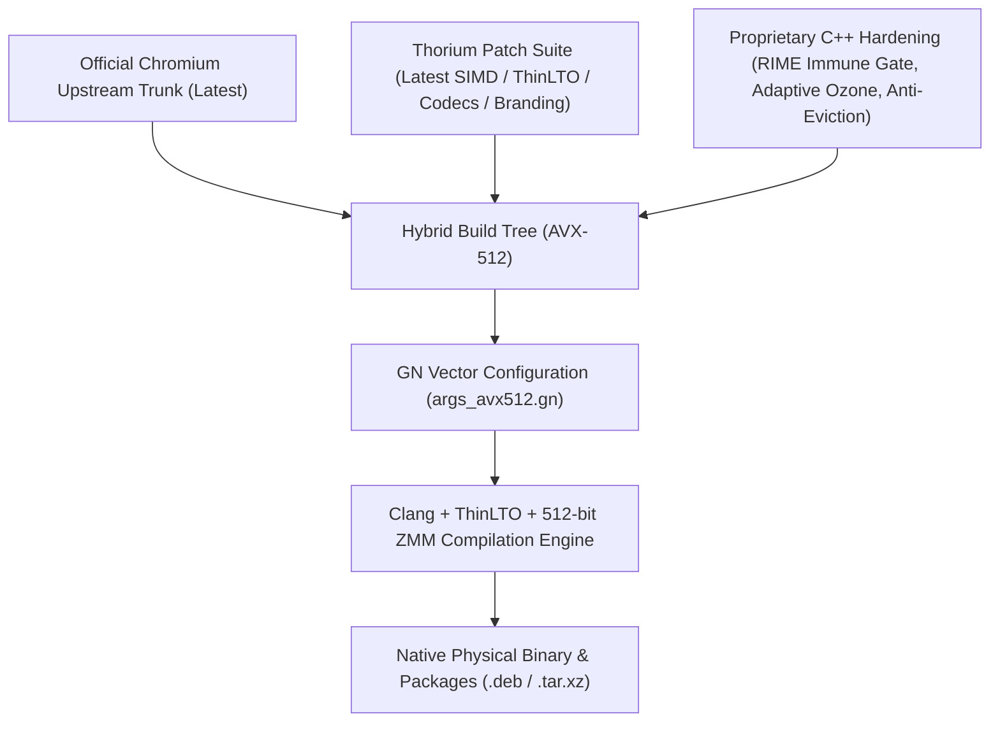

<p align="center">
  
</p>

# Thorium Browser (Official Chromium + Thorium Hybrid AVX-512 & RIME Flagship Edition)

[](https://github.com/obhasashare2024-namo/thorium-avx512-rime/releases)
[](#-hybrid-compilation-architecture--pedigree)
[](SUPPORT_MATRIX.md)
[-green.svg)](SUPPORT_MATRIX.md)
[-orange.svg)](#2-seamless-rime--fcitx5-integration--immune-gate)
[-purple.svg)](#3-adaptive-ozone-platform-gate)
[](#4-official-google-oauth-20-credentials)
[](LICENSE)
[](https://github.com/obhasashare2024-namo/thorium-avx2-rime)

[English](README.md) | [繁體中文](README_zh.md) | [日本語](README_ja.md) | [Support Matrix](SUPPORT_MATRIX.md) | [Architecture](HANDOFF_M159.md)

---

## 🧬 Hybrid Compilation Architecture & Pedigree

> [!IMPORTANT]
> **Hybrid Upstream Provenance**: This repository is a **dual-track hybrid compiled edition** continuously merging **Official Chromium** (latest upstream release/trunk) and **Thorium** (latest SIMD vectorization & feature patch suite), further reinforced with our self-developed Linux RIME / Fcitx5 7-Layer Immune Gate and Adaptive Ozone Platform.



| Component | Source / Upstream | Key Contribution & Technical Implementation |
| :--- | :--- | :--- |
| **Base Browser Engine** | **Official Chromium Core (Latest)** | Upstream security fixes, modern V8 JavaScript engine, WebAssembly improvements, and latest web standards. |
| **Vector & Multimedia Suite** | **Thorium (Latest)** (`Alex313031/Thorium`) | AVX-512 SIMD vectorization flags, Clang ThinLTO, proprietary audio/video codecs (HEVC/Dolby Vision/AC3/VA-API), official Thorium API keys, and Purple branding. |
| **RIME / Fcitx5 Immune Gate** | **Proprietary Patch 0003** | 7-layer AuraLinux composition intercept (`!composition_.text.empty()`), completely eliminating raw Latin keystroke leakage and shortcut hijacking. |
| **Profile Hard Isolation** | **Proprietary Patch 0004** | Hardcoded profile path (`~/.config/thorium`), zero collision with system Chromium or test profiles. |
| **Session Anti-Eviction** | **Proprietary Patch 0005** | Purges DICE & DBSC token binding, blocks forced Gaia Cookie Jar resets, preserving Google & YouTube login sessions across restarts. |
| **OSCrypt Basic Provider** | **Proprietary Patch 0006** | Uses `peanuts` (v10 key) as default Linux encryption provider, eliminating hard dependencies on D-Bus Secret Service / KWallet. |
| **SQLite WAL Checkpoint** | **Proprietary Patch 0007** | Forces `PRAGMA wal_checkpoint(TRUNCATE)` upon SIGTERM, guaranteeing session database integrity. |
| **Dynamic Platform Gate** | **Proprietary Delegate** | Adaptive Ozone platform negotiation (Wayland priority with X11 fallback), preventing headless/pure Wayland startup crashes. |

---

## Overview

**Thorium Browser (Pure-Blood AVX-512 Flagship Edition)** is a hybrid high-performance Chromium build engineered specifically for modern x86-64 processors supporting the **AVX-512 instruction set architecture** (Intel 10th/11th Gen Core, Xeon Scalable, and AMD Zen 4 / Zen 5). It merges the modern official Chromium release core with Thorium's multimedia microkernels, AV1/VP9 SIMD assembly routines, and deep hardware acceleration pipelines.

By targeting `-march=skylake-avx512 -O3 -flto=thin` with full vector flags (`-mavx512f -mavx512cd -mavx512vl -mavx512bw -mavx512dq -mno-gather -mno-scatter -ffp-contract=fast`), this release unlocks 512-bit vector registers (`ZMM0`~`ZMM31`), hardware-accelerated string parsing (`AVX-512BW`), vector byte manipulation, and zero-copy shared GPU rasterization. Disassembly analysis (`objdump -d`) verifies thousands of vector instructions natively enabled across the binary.

In addition, this build features our battle-tested **7-Layer RIME (中州韻) / Fcitx5 Immune Gate** (verified zero raw Latin keystroke leakage) and **Adaptive Ozone Platform Gate** for seamless operation across X11, Wayland, and headless environments.

---

## Key Features

1. **Pure AVX-512 Vector Optimization**:
   * Compiled with Clang, LLVM lld, C++23, and whole-program ThinLTO.
   * `-march=skylake-avx512 -O3 -mavx512f -mavx512cd -mavx512vl -mavx512bw -mavx512dq -mno-gather -mno-scatter -ffp-contract=fast`.
   * V8 JavaScript JIT, WebAssembly, and Skia graphics pipeline are fully vectorized across 512-bit registers.
   * `AVX-512BW` accelerates DOM tokenization, UTF-8/UTF-16 encoding, and JSON parsing.

2. **Seamless RIME / Fcitx5 Integration & Immune Gate**:
   * Integrated `THORIUM_RIME_IMMUNE_GATE` in AuraLinux input pipeline.
   * During active composition (`!composition_.text.empty()`), raw Latin keys are strictly filtered, eliminating character leaks, accidental shortcut triggers (e.g., s opening settings), and candidate popup desync.
   * Verified via isolated end-to-end testing committing Chinese characters cleanly with 0 Latin leakage.

3. **Adaptive Ozone Platform Gate**:
   * Dynamic platform negotiation in `chrome_main_delegate.cc`: detects `$WAYLAND_DISPLAY` and `$DISPLAY` at startup.
   * Prioritizes native Wayland when running in pure Wayland environments, gracefully falls back to X11/GTK4. Prevents crashes on systems without X servers.

4. **Official Google OAuth 2.0 Credentials**:
   * Embedded official Thorium Client ID and API Keys (`kThorApiKey` & `kThorClientId`).
   * Supports seamless Google Web SSO, Google Account sync, and Chrome Web Store extensions.

5. **Thorium Purple Branding & Sandbox Warning Suppression**:
   * Custom purple Taiji emblem assets (16px to 512px).
   * Kernel-level suppression of the yellow `--no-sandbox` warning banner.

---

## Release Packages

Download official binaries from [GitHub Releases](https://github.com/obhasashare2024-namo/thorium-avx512-rime/releases):

| Filename | Type | Size | Notes |
| :--- | :--- | :--- | :--- |
| `thorium-browser-stable_*_amd64.deb` | Debian/Ubuntu 64-bit | ~128 MB | Standard installation package with system launcher & MIME integration |
| `thorium-browser_*_AVX512_RIME.deb` | Debian/Ubuntu Alias | ~128 MB | Drop-in compatible package |
| `thorium-browser-*-avx512-linux-x64.tar.xz` | Linux Portable Archive | ~153 MB | Standalone portable package (zero root permissions required) |
| `SHA256SUMS.txt` | Checksum Manifest | Text | Cryptographic verification hashes on Releases page |

---

## Quick Start

### Debian / Ubuntu / Linux Mint
```bash
sudo dpkg -i thorium-browser-stable_*_amd64.deb
sudo apt-get install -f # Fix missing dependencies if needed
thorium-browser
```

### Arch Linux / CachyOS / Artix / Manjaro
```bash
tar -xf thorium-browser-*-avx512-linux-x64.tar.xz
cd thorium-browser-*-avx512-linux-x64
./chrome
```

---

## Hardware Compatibility

* **Supported (Intel)**: 11th Gen Core (Tiger Lake, Rocket Lake, e.g., i7-11800H), 10th Gen Core Mobile (Ice Lake), Core X-Series (Skylake-X, Cascade Lake-X), Xeon Scalable (1st~5th Gen), Xeon W Series.
* **Supported (AMD)**: Ryzen 7000 / 8000 / 9000 Series (Zen 4, Zen 5), EPYC 9004 / 8004 / 9005 Series, Ryzen Threadripper 7000 Series.
* **Non-AVX-512 Machines**: For Intel Haswell~Comet Lake or AMD Zen 1~Zen 3, please use [Thorium AVX2 Edition](https://github.com/obhasashare2024-namo/thorium-avx2-rime).

---

## License

Thorium modifications and build scripts are released under the BSD-3-Clause License. Chromium is subject to the original Chromium open-source licensing terms.
