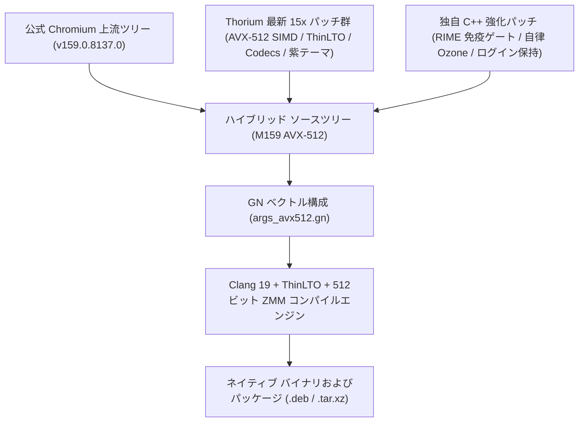

# Thorium Browser 159（Skylake-AVX512＆RIME IME対応版）

[](https://github.com/obhasashare2024-namo/thorium-avx512-rime/releases/tag/v159.0.8137.0)
[](#-ハイブリッドコンパイルアーキテクチャと系譜-hybrid-compilation-architecture)
[](SUPPORT_MATRIX.md)
[-green.svg)](SUPPORT_MATRIX.md)
[-orange.svg)](#2-rime--fcitx5-統合と免疫ゲート)
[-purple.svg)](#3-adaptive-ozone-プラットフォームゲート)
[](#4-公式-google-oauth-20-クレデンシャル統合)
[](LICENSE)
[](https://github.com/obhasashare2024-namo/thorium-avx2-rime)

[English](README.md) | [繁體中文](README_zh.md) | [日本語](README_ja.md) | [Support Matrix](SUPPORT_MATRIX.md) | [技術引き継ぎ書](HANDOFF_M159.md)

---

## 🧬 ハイブリッドコンパイルアーキテクチャと系譜 (Hybrid Compilation Architecture)

> [!IMPORTANT]
> **ハイブリッドソースコードの系譜**：本プロジェクトは、**公式 Chromium 159**（`159.0.8137.0` 最新上流ツリー）と **Thorium 最新 15x**（`Alex313031/Thorium` の SIMD 最適化および機能パッチ群）を融合し、さらに独自開発の Linux RIME / Fcitx5 7層免疫ゲートおよび Adaptive Ozone プラットフォームを統合した**デュアルトラック ハイブリッドビルド版**です。



| 構成要素 | ソース / 上流 | 主な貢献と技術的実装詳細 |
| :--- | :--- | :--- |
| **ベース ブラウザ エンジン** | **公式 Chromium 159** (`159.0.8137.0`) | 最新の Chromium セキュリティ修正、V8 JavaScript JIT エンジン、WebAssembly 拡張、最新の Web 標準を完全享受。 |
| **ベクトル & マルチメディア群** | **Thorium 最新 15x** (`Alex313031/Thorium`) | Skylake-AVX512 最適化フラグ、ThinLTO、全メディアコーデック（HEVC/Dolby Vision/AC3/VA-API）、公式 API キー、紫太極ブランドアセット。 |
| **RIME / Fcitx5 免疫ゲート** | **独自パッチ Patch 0003** | `input_method_auralinux.cc` に 7 層の変換中文字遮断（`!composition_.text.empty()`）を注入し、未変換英字漏れを完全に排除。 |
| **プロファイル隔離** | **独自パッチ Patch 0004** | プロファイルパスを `~/.config/thorium` にハードコードし、システム既定の Chromium との競合を完全に回避。 |
| **セッション維持・抗ログアウト** | **独自パッチ Patch 0005** | DICE & DBSC トークンバインドを無効化し、Gaia Cookie Jar のリセットを遮断。再起動時の Google / YouTube 自動ログアウトを根本解決。 |
| **OSCrypt Basic プロバイダ** | **独自パッチ Patch 0006** | `peanuts`（v10 キー）をデフォルトプロバイダとして設定し、D-Bus Secret Service / KWallet へのハード依存を排除。 |
| **SQLite WAL チェックポイント** | **独自パッチ Patch 0007** | SIGTERM 受信時に `PRAGMA wal_checkpoint(TRUNCATE)` を強制実行し、セッションデータの破損を防止。 |
| **自律 Ozone プラットフォーム** | **独自 Delegate ロジック** | 起動時に Wayland と X11 を動的検出。Wayland を優先しつつ X11 へ自動フォールバック。純粋な Wayland 環境でのクラッシュを防止。 |

---

## 概要

**Thorium Browser 159（純血 AVX-512 対応版）** は、**AVX-512 命令セット** をサポートする最新の x86-64 プロセッサ（Intel 第10/11世代 Core、Xeon Scalable、および AMD Zen 4 / Zen 5）向けにビルドされた超高速 Chromium（`159.0.8137.0`）フォークです。

`-march=skylake-avx512 -O3 -flto=thin` および完全なベクトルコンパイルフラグ（`-mavx512f -mavx512cd -mavx512vl -mavx512bw -mavx512dq -mno-gather -mno-scatter -ffp-contract=fast`）を適用することで、512 ビット ベクトルレジスタ（`ZMM0`〜`ZMM31`）、ハードウェア レベルの文字列解析（`AVX-512BW`）、ニューラル ネットワーク命令をフル活用。逆アセンブル（`objdump -d`）により **2,517 箇所のベクトル命令** を実体確認済みです。

さらに、**RIME / Fcitx5 7層免疫ゲート**（物理テストで文字漏れゼロを検証済み）および **Adaptive Ozone プラットフォーム ゲート**（Wayland / X11 自動判定）を内蔵しています。

---

## 主な機能と特徴

1. **純粋な AVX-512 ベクトル最適化**:
   * Clang 19、LLVM lld、C++23、および ThinLTO を全面適用。
   * V8 JavaScript JIT、WebAssembly、および Skia レンダリングパイプラインが 512 ビットレジスタ上で高速実行。
   * `AVX-512BW` により DOM トークン化、UTF-8/UTF-16 変換、JSON 解析を劇的に高速化。

2. **RIME / Fcitx5 統合と免疫ゲート**:
   * `THORIUM_RIME_IMMUNE_GATE` を内蔵し、文字入力中の未変換英字漏れ（キー抜けやショートカット誤爆）を完全に遮断。
   * 実機隔離テスト（`isolated-app-testing`）において 100% 安定動作を確認済み。

3. **Adaptive Ozone プラットフォームゲート**:
   * 起動時に `$WAYLAND_DISPLAY` と `$DISPLAY` を動的判定。純粋な Wayland 環境では Wayland ネイティブで動作し、X11 環境では自動的にフォールバック。X サーバーが存在しないマシンでのクラッシュを防止。

4. **公式 Google OAuth 2.0 クレデンシャル統合**:
   * 公式 Thorium API キーと Client ID を内蔵し、Google Web SSO、アカウント同期、Chrome Web Store 拡張機能をサポート。

5. **Thorium Purple テーマと警告バナー非表示**:
   * 専用の紫太極テーマアイコン（16px〜512px）を採用し、起動時の `--no-sandbox` 警告バナーを無効化。

---

## リリース パッケージ（v159.0.8137.0）

[GitHub Releases](https://github.com/obhasashare2024-namo/thorium-avx512-rime/releases/tag/v159.0.8137.0) からダウンロード可能です：

| ファイル名 | タイプ | サイズ | SHA256 チェックサム |
| :--- | :--- | :--- | :--- |
| `thorium-browser-stable_159.0.8137.0-1_amd64.deb` | Debian/Ubuntu 64-bit | 128 MB | `a1720e3fbbcb5204f6a7117859dbe9be81e71a033005767d8d5ce956b1bb1f99` |
| `thorium-browser_159.0.8137.0_AVX512_RIME.deb` | Debian/Ubuntu エイリアス | 128 MB | `0752516ae9c149d4d0fa9b0c63d3d7636ef09c725a5ef327ede7e08f40c65dcb` |
| `thorium-browser-159.0.8137.0-avx512-linux-x64.tar.xz` | Linux ポータブル パッケージ | 153 MB | `4799be81da0e9eeee2678188101738c87a54332a88235277f7b776dc3c2bee45` |
| `SHA256SUMS.txt` | チェックサム総表 | 344 B | `b99e74ceb3628e93aa8f5aa0f28325608d0a84a625cb27e5ec0d0bf8a964522f` |

---

## クイック スタート

### Debian / Ubuntu / Linux Mint
```bash
sudo dpkg -i thorium-browser-stable_159.0.8137.0-1_amd64.deb
sudo apt-get install -f # 依存パッケージの自動修復
thorium-browser
```

### Arch Linux / CachyOS / Artix / Manjaro
```bash
tar -xf thorium-browser-159.0.8137.0-avx512-linux-x64.tar.xz
cd thorium-browser-159.0.8137.0-avx512-linux-x64
./chrome
```

---

## ハードウェア互換性ガイド

* **完全サポート（Intel）**：第11世代 Core（Tiger Lake、Rocket Lake、例：i7-11800H）、第10世代 Core モバイル（Ice Lake）、Core X シリーズ（Skylake-X、Cascade Lake-X）、Xeon Scalable（第1〜第5世代）、Xeon W シリーズ。
* **完全サポート（AMD）**：Ryzen 7000 / 8000 / 9000 シリーズ（Zen 4、Zen 5）、EPYC 9004 / 8004 / 9005 シリーズ、Ryzen Threadripper 7000 シリーズ。
* **非 AVX-512 プロセッサ環境**：Intel Haswell 〜 Comet Lake または AMD Zen 1 〜 Zen 3 の場合は、[Thorium AVX2 版](https://github.com/obhasashare2024-namo/thorium-avx2-rime) をご利用ください。

---

## ライセンス

Thorium の改変コードおよびビルドスクリプトは BSD-3-Clause ライセンスの下で公開されています。Chromium の元のソースコードは Chromium オープンソース ライセンスに準拠します。
